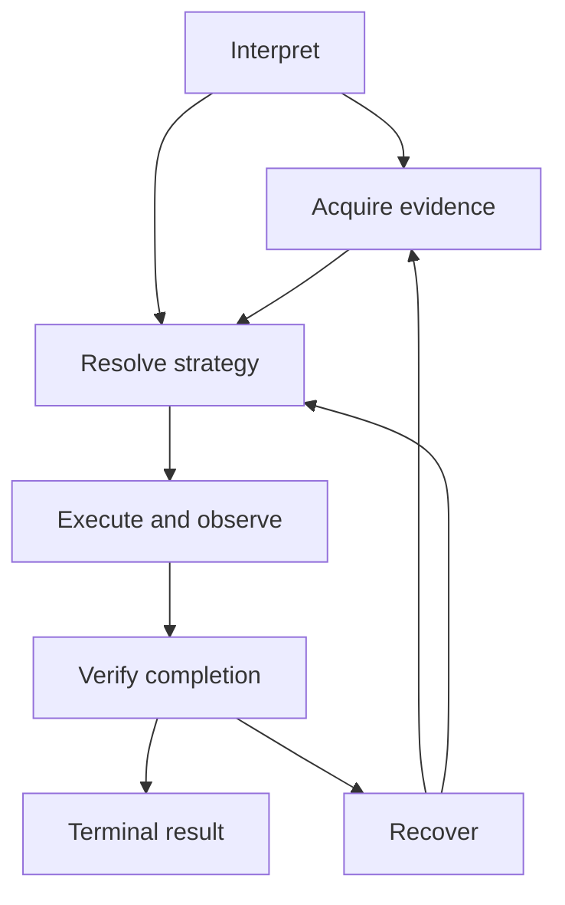

# A015 Unified Agent Runtime

Status: Stage A behavior implemented on research/a015-unified-agent-runtime; physical evidence verified; independent review and authorized integration pending.
Approved direction: Approach 3. Spec: ../superpowers/specs/2026-10-12-a015-unified-agent-runtime-design.md.
Behavior checkpoint: c968330cf97d7a7c7893aa70fddd150ce8dd510e.

AgentRuntime.run accepts ordinary Unicode text, AgentRequest, or a closed mapping with text and optional opaque request_id/language_hint. Caller routing, policy, procedure and expected-answer controls are rejected. Every request creates a fresh RunControl, immutable accepted GoalContract, initial in-memory state, global ledger and terminal latch.

Selective MODEL_ASSIST can be entered by interpretation, acquisition, resolution or recovery and returns only to its recorded requesting phase. The controller enforces the complete approved FSM, including EXECUTING → OBSERVING → VERIFYING, bounded repair and legal terminal unwinding. Model output cannot publish success directly.

The interpreter binds original text to closed public task schemas. The trusted compiler creates nonempty completion predicates. Acquisition uses configured A005 indexes, query-only A014 hybrid routing and real target-free A013 expansion. A006 SINGLE_BEST selection assembles accounted context and complete relation constituents. Strategy resolution discovers compatible public roots, finite compositions and selectively proposed repairs. An injected execution port adapts validated plans to unchanged A008 CHUNKED execution.

Completion verification independently checks registered capability identity, ordered observations, execution receipt, state revisions, actual costs and original accepted goal predicates. SUCCEEDED requires matching run/goal/candidate/data identities and fresh state. Recovery keeps the same goal and ledger, requires meaningful context/plan change and uses a fresh execution state/ID. Unchanged remedies terminate with NO_PROGRESS.

| Component | Treatment | Boundary |
| --- | --- | --- |
| A003 familiarity | Reusable leaf concept / legacy baseline | No orchestration ownership |
| A004 model adapter | Reuse behind pinned broker/transport | All generation roles share admissions |
| A005 vector memory | Reuse exact indexes | Setup separate; memory/catalog share query budget |
| A006 selection | Reuse SINGLE_BEST | Local activation adapted to global context accounting |
| A007 uncertainty | Adapt concepts | New typed deficits and bounded recovery |
| A008 procedures | Reuse CHUNKED mechanics | New validated bindings, observations and fresh state |
| A009 loop | Historical baseline only | New controller owns lifecycle |
| A010 comparison | Historical baseline and cost caution | Selectivity does not imply savings in every resource |
| A011 release/profile | Preserved historical anchors | 67 protected paths, release tag and conclusions retained |
| A012 relational reasoning | Historical baseline / reusable semantics | No second-search wrapper |
| A013 relation activation | Reuse target-free expand | Actual invocations, visits, edges and proofs |
| A014 routing | Reuse HYBRID_RULE_THEN_MODEL | Unchanged five-relation schema and 192-output request |

Stage A executes only PURE and IN_MEMORY capabilities. Model/embedding inference is configured infrastructure. Future capability registry, authorization, proposal/execution, effect journal, retries, cancellation, observation, verification and compensation ports form extension seams; Stage B/C external effects and learned persistence remain unimplemented.

The frozen bilingual workload has 64 requests /32 semantic pairs. Direct pinned qwen3.5:4b receives the complete identical public corpus and proposes one solution; shared mechanical validation/execution/verification uses no selective acquisition, ranking or recovery. Portable engineering evidence is labeled scripted and cannot establish physical cost preference. Physical comparison retains three repetitions, all failed attempts, unknown usage and negative/mixed outcomes.

Content-addressed per-run artifacts retain goals, context, plans, receipts, observations, candidates and verification control snapshots within existing trace/state bounds. Raw broker records retain prompts, settings, outputs and response identities. Offline evidence validation binds these to source mode/path/blob closure, frozen G2 inputs, approved spec, backend identity and independent oracle verdicts.

A010's historical retrieval/computation caution and A014's frozen Hybrid32/32 with9 calls versus Model-only32 remain historical evidence, not A015 measurements. No Stage B/C, release/version promotion or next milestone is activated by this implementation.

## Physical qualification result

The frozen physical run completed384 trials on CDQ-P with trustworthy source
and usage evidence. Research outcome: UNIFIED_RUNTIME_NOT_SUPPORTED. Unified
completes138/144 solvable tasks and all48 non-success controls with zero false
success/invariant failures, but demonstrates zero genuine successful recovery.
Direct completes0/144 with192 rejected closed-schema proposals; all cost and
raw outputs remain retained. The new runtime's finite public-domain coverage
does not establish general conversational or external-action capability.

See [measured report](../development/reports/ASCA-20261012-A015-unified-agent-runtime.md)
and [evidence](../development/qualification/a015-agent-runtime-physical-v1.json).
Behavior fingerprint and frozen inputs are unchanged. Engineering review/CI and
the chosen integration path still gate DONE; no automatic release or Stage B/C.
